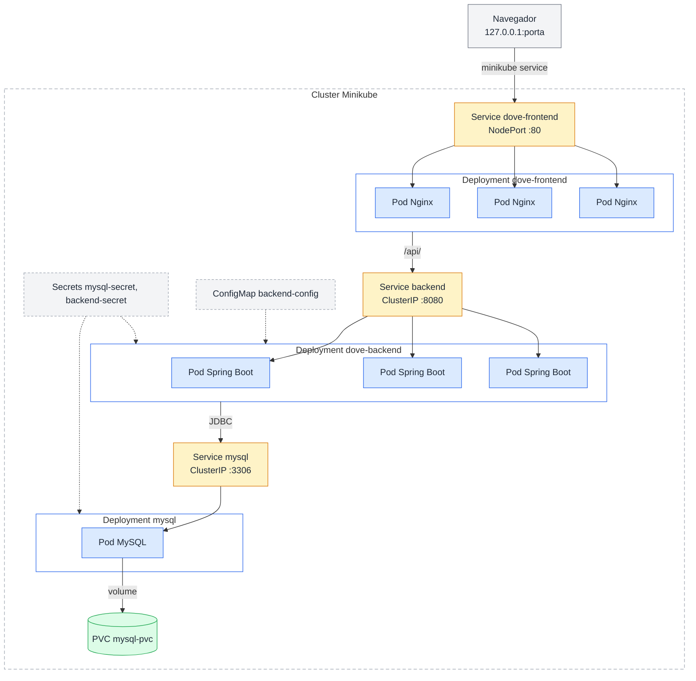
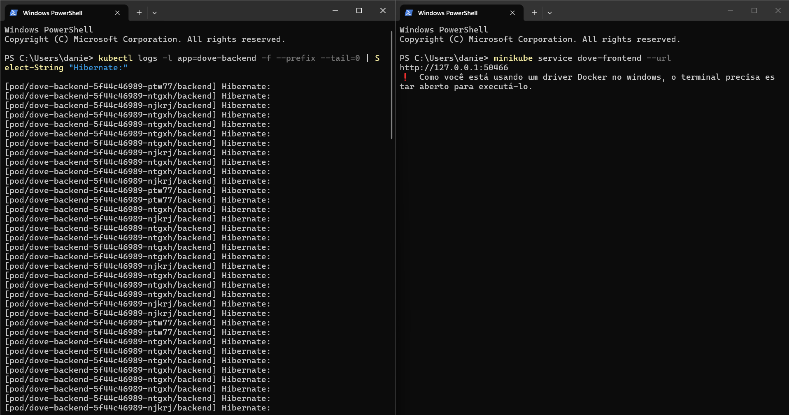
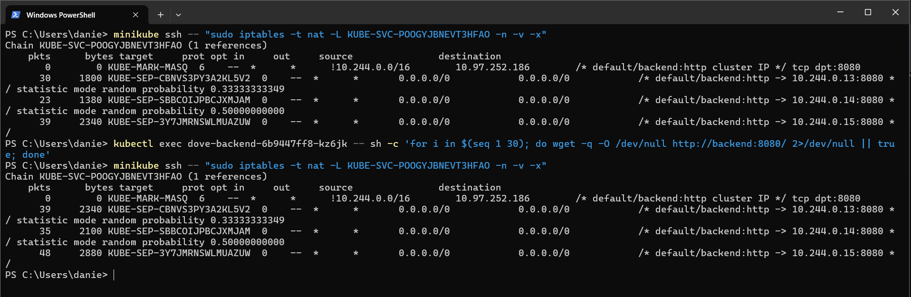
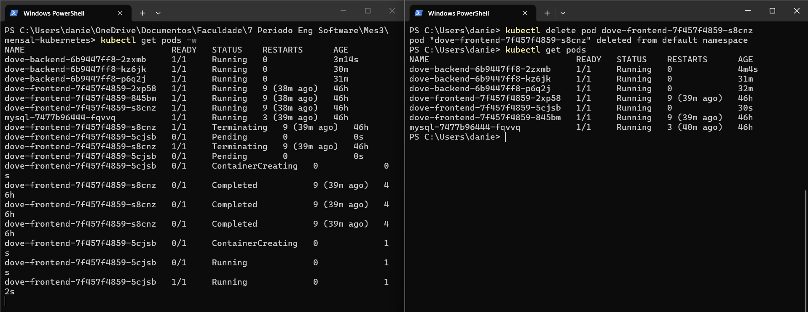
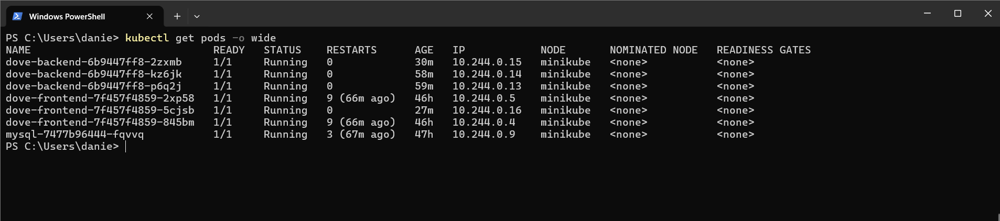
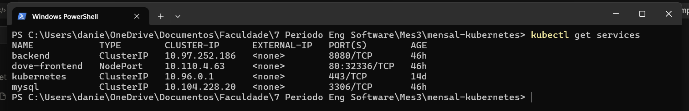
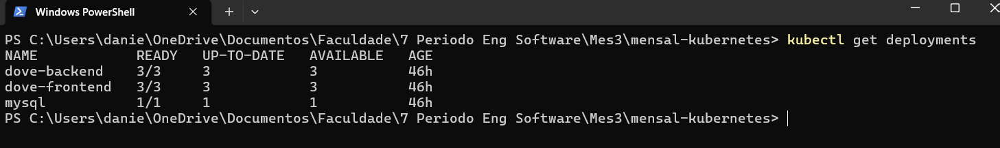
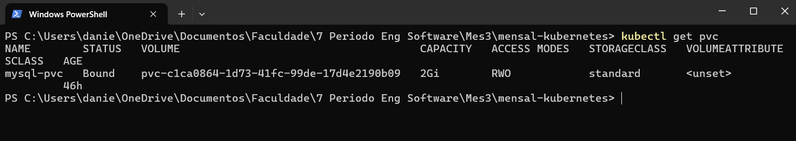
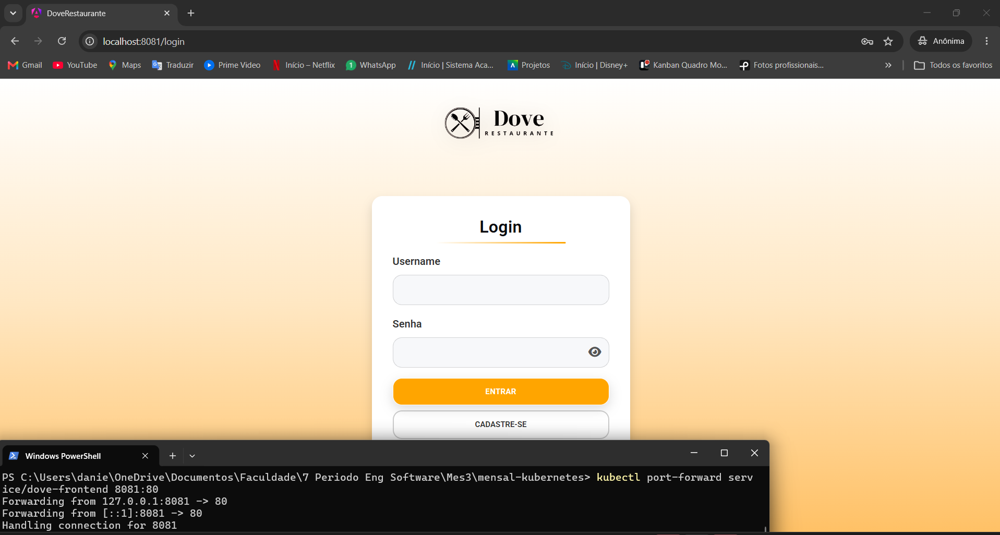
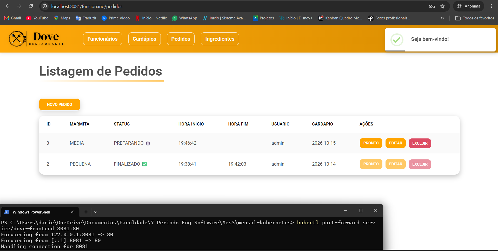

# Dove Restaurante no Kubernetes (Minikube)

Migração da aplicação Dove Restaurante, desenvolvida no Mensal 1 e originalmente orquestrada com Docker Compose, para um cluster Kubernetes local gerenciado pelo Minikube.

Todos os componentes da aplicação (frontend, backend e banco de dados) executam dentro do cluster. O Docker Desktop é usado apenas como driver do Minikube e para construir as imagens.

**Tecnologias:** Angular 19 + Nginx, Java 17 + Spring Boot, MySQL 8.4, Docker, Minikube e kubectl.

## Sumário

1. [Arquitetura](#1-arquitetura)
2. [Estrutura do repositório](#2-estrutura-do-repositório)
3. [Pré-requisitos](#3-pré-requisitos)
4. [Clonar o projeto](#4-clonar-o-projeto)
5. [Iniciar o Minikube](#5-iniciar-o-minikube)
6. [Construir as imagens](#6-construir-as-imagens)
7. [Disponibilizar as imagens no Minikube](#7-disponibilizar-as-imagens-no-minikube)
8. [Criar os Secrets](#8-criar-os-secrets)
9. [Aplicar os manifestos](#9-aplicar-os-manifestos)
10. [Verificar os recursos](#10-verificar-os-recursos)
11. [Acessar a aplicação](#11-acessar-a-aplicação)
12. [Balanceamento de carga](#12-balanceamento-de-carga)
13. [Self-healing](#13-self-healing)
14. [Persistência do banco](#14-persistência-do-banco)
15. [Evidências](#15-evidências)
16. [Conceitos do Kubernetes utilizados](#16-conceitos-do-kubernetes-utilizados)
17. [Do Docker Compose para o Kubernetes](#17-do-docker-compose-para-o-kubernetes)
18. [Solução de problemas](#18-solução-de-problemas)

## 1. Arquitetura



**Legenda:** amarelo = Service, azul = Pod, verde = volume persistente, cinza tracejado = configuração.

### Comunicação entre os componentes

- O navegador acessa somente o **frontend**, pela URL que o comando `minikube service` mostra. O comando abre um túnel até o NodePort do Service `dove-frontend`, que distribui as requisições entre os 3 Pods do Nginx.
- O **Nginx** do frontend encaminha as requisições `/api/` para o Service `backend`, usando o DNS interno do cluster.
- O Service `backend` distribui as conexões entre os 3 Pods com o rótulo `app=dove-backend`.
- O **backend** conecta ao banco pelo nome DNS `mysql`, definido no ConfigMap.
- O **MySQL** grava os dados em um volume persistente (PVC).

Os Services fornecem endereços estáveis, então nenhum componente depende dos IPs dos Pods, que mudam a cada recriação.

Como o Nginx faz o proxy de `/api/`, o navegador enxerga frontend e API na mesma origem (a URL aberta pelo `minikube service`), sem necessidade de configuração de CORS para o acesso via cluster.

### Recursos Kubernetes

| Arquivo | Recurso | Finalidade |
|---|---|---|
| `k8s/mysql-pvc.yaml` | PersistentVolumeClaim `mysql-pvc` | Armazenamento persistente de 2Gi |
| `k8s/mysql-deployment.yaml` | Deployment `mysql` | MySQL 8.4, 1 réplica, estratégia `Recreate`, readiness probe |
| `k8s/mysql-service.yaml` | Service `mysql` (ClusterIP) | Acesso interno na porta 3306 |
| `k8s/backend-configmap.yaml` | ConfigMap `backend-config` | Configurações não sigilosas (perfil Spring, JDBC, usuário) |
| `k8s/backend-deployment.yaml` | Deployment `dove-backend` | Spring Boot, 3 réplicas, startup, readiness e liveness probes |
| `k8s/backend-service.yaml` | Service `backend` (ClusterIP) | Balanceamento interno na porta 8080 |
| `k8s/frontend-deployment.yaml` | Deployment `dove-frontend` | Angular/Nginx, 3 réplicas, readiness probe |
| `k8s/frontend-service.yaml` | Service `dove-frontend` (NodePort) | Exposição do frontend fora do cluster, porta 80 |
| Criado por comando | Secret `mysql-secret` | Senhas do MySQL |
| Criado por comando | Secret `backend-secret` | Chave de assinatura JWT |

Os Secrets são criados por comando (seção 8) para que nenhuma senha seja versionada no repositório.

O MySQL usa a estratégia `Recreate` porque o PVC é `ReadWriteOnce`: em uma atualização, o Pod antigo é encerrado antes de o novo ser criado, evitando dois Pods disputando o mesmo volume.

## 2. Estrutura do repositório

```text
dove-kubernetes/
├── README.md
├── .gitignore
├── dove-restaurante-api/      # Backend Spring Boot
│   ├── Dockerfile
│   ├── pom.xml
│   ├── mvnw
│   ├── .mvn/
│   └── src/
├── dove-restaurante-web/      # Frontend Angular
│   ├── Dockerfile
│   ├── nginx.conf
│   ├── package.json
│   ├── package-lock.json
│   └── src/
├── k8s/                       # Manifestos Kubernetes
│   ├── backend-configmap.yaml
│   ├── backend-deployment.yaml
│   ├── backend-service.yaml
│   ├── frontend-deployment.yaml
│   ├── frontend-service.yaml
│   ├── mysql-deployment.yaml
│   ├── mysql-pvc.yaml
│   └── mysql-service.yaml
└── evidencias/                # Capturas de tela
```

### Dockerfiles

- **Backend** (`dove-restaurante-api/Dockerfile`): build em duas etapas. A primeira compila o projeto com Maven Wrapper (`./mvnw clean package -DskipTests`) usando o JDK 17; a segunda executa o WAR gerado com o JRE 17, com um usuário sem privilégios de administrador.
- **Frontend** (`dove-restaurante-web/Dockerfile`): build em duas etapas. Usa Node 20 para compilar o Angular (`npm ci` e build para `dist/dove-restaurante/browser`) e Nginx para servir os arquivos estáticos e fazer o proxy da API.

## 3. Pré-requisitos

Instruções para Windows com PowerShell.

1. **Docker Desktop**, com backend WSL 2 habilitado: https://www.docker.com/products/docker-desktop/
2. **Minikube**: https://minikube.sigs.k8s.io/docs/start/
3. **kubectl**: https://kubernetes.io/docs/tasks/tools/install-kubectl-windows/
4. **Git**: https://git-scm.com/downloads/win

Com o Docker Desktop aberto e em execução, abra um novo PowerShell e confira:

```powershell
docker version
minikube version
kubectl version --client
git --version
```

Se algum comando não for reconhecido, conclua a instalação correspondente e reabra o PowerShell.

## 4. Clonar o projeto

```powershell
git clone https://github.com/Daniidd/dove-kubernetes.git
cd dove-kubernetes
Get-ChildItem .\k8s\
```

Todos os comandos seguintes devem ser executados a partir da raiz do repositório.

## 5. Iniciar o Minikube

```powershell
minikube start --driver=docker
kubectl config current-context
kubectl get nodes
minikube status
```

**Resultado esperado:** contexto `minikube` e nó em estado `Ready`. Se o cluster já existir, o mesmo comando apenas o reinicia.

## 6. Construir as imagens

```powershell
docker build -t mensal-backend:latest .\dove-restaurante-api
docker build -t mensal-frontend:latest .\dove-restaurante-web
docker image ls mensal-backend
docker image ls mensal-frontend
```

O build pode levar alguns minutos na primeira execução.

## 7. Disponibilizar as imagens no Minikube

Os Deployments usam `imagePullPolicy: Never`, então as imagens precisam estar dentro do runtime do Minikube (não basta existirem no Docker Desktop):

```powershell
minikube image load mensal-backend:latest
minikube image load mensal-frontend:latest
minikube image ls | Select-String mensal
```

As duas imagens devem aparecer na listagem. A imagem `mysql:8.4` é pública e será baixada automaticamente.

## 8. Criar os Secrets

Os Secrets precisam existir **antes** dos Deployments. Defina senhas próprias para o seu ambiente:

```powershell
$mysqlRoot = Read-Host "Senha root do MySQL"
$mysqlApp  = Read-Host "Senha do usuario dove_user"
$jwtKey    = Read-Host "Chave JWT (minimo 32 caracteres)"

kubectl create secret generic mysql-secret `
  --from-literal="MYSQL_ROOT_PASSWORD=$mysqlRoot" `
  --from-literal="MYSQL_PASSWORD=$mysqlApp"

kubectl create secret generic backend-secret `
  --from-literal="SECRET_KEY=$jwtKey"

Remove-Variable mysqlRoot, mysqlApp, jwtKey
kubectl get secrets
```

| Secret | Chave | Usada por |
|---|---|---|
| `mysql-secret` | `MYSQL_ROOT_PASSWORD` | Deployment `mysql` |
| `mysql-secret` | `MYSQL_PASSWORD` | Deployment `mysql` e Deployment `dove-backend` (como `DB_PASSWORD`) |
| `backend-secret` | `SECRET_KEY` | Deployment `dove-backend` (assinatura JWT com HMAC256) |

Guarde a senha do `dove_user`: ela será usada na seção 11.

## 9. Aplicar os manifestos

A ordem importa: banco, depois backend, depois frontend.

### 9.1 Banco de dados

```powershell
kubectl apply -f .\k8s\mysql-pvc.yaml
kubectl apply -f .\k8s\mysql-service.yaml
kubectl apply -f .\k8s\mysql-deployment.yaml
kubectl rollout status deployment/mysql --timeout=180s
kubectl get pvc
```

**Esperado:** Deployment `mysql` disponível e PVC `mysql-pvc` com status `Bound`.

### 9.2 Backend

```powershell
kubectl apply -f .\k8s\backend-configmap.yaml
kubectl apply -f .\k8s\backend-service.yaml
kubectl apply -f .\k8s\backend-deployment.yaml
kubectl rollout status deployment/dove-backend --timeout=400s
```

O ConfigMap define `SPRING_PROFILES_ACTIVE=prod`, `DB_URL=jdbc:mysql://mysql:3306/dove` e `DB_USERNAME=dove_user`. O perfil `prod` faz o Spring Boot carregar o `application-prod.properties`, que lê essas variáveis. A senha vem do Secret `mysql-secret`. Na primeira inicialização, o Hibernate cria as tabelas do banco.

O backend possui três probes do tipo `tcpSocket` na porta 8080:

- **Startup probe:** dá até 6 minutos para o Spring Boot iniciar. Enquanto ela não passa, as outras probes não são verificadas, então uma inicialização lenta (por exemplo, com as 3 réplicas subindo ao mesmo tempo depois de um `minikube start`) não faz o contêiner ser reiniciado.
- **Readiness probe:** o Pod só passa a receber tráfego do Service depois que o Spring Boot abre a porta. Assim, o `rollout status` só conclui quando a aplicação está de fato no ar.
- **Liveness probe:** se a porta deixar de responder depois que a aplicação já subiu, o Kubernetes reinicia o contêiner automaticamente.

A verificação é por TCP, e não por HTTP, porque a rota `/` responde 403 por causa do Spring Security, o que o Kubernetes consideraria falha.

### 9.3 Frontend

```powershell
kubectl apply -f .\k8s\frontend-service.yaml
kubectl apply -f .\k8s\frontend-deployment.yaml
kubectl rollout status deployment/dove-frontend --timeout=180s
```

## 10. Verificar os recursos

```powershell
kubectl get pods -o wide
kubectl get services
kubectl get deployments
kubectl get pvc
kubectl get configmaps
kubectl get secrets
```

**Estado esperado:**

| Recurso | Estado |
|---|---|
| Deployment `dove-frontend` | 3/3 réplicas prontas |
| Deployment `dove-backend` | 3/3 réplicas prontas |
| Deployment `mysql` | 1/1 réplica pronta |
| PVC `mysql-pvc` | `Bound` |
| Services | `dove-frontend` (NodePort), `backend` (ClusterIP), `mysql` (ClusterIP) |

Nomes de Pods, IPs e NodePorts são gerados dinamicamente e serão diferentes em cada instalação.

## 11. Acessar a aplicação

### 11.1 Abrir no navegador

Em um **novo PowerShell**, mantendo-o aberto:

```powershell
minikube service dove-frontend --url
```

O comando abre um túnel até o NodePort do Service `dove-frontend` e mostra a URL de acesso, por exemplo `http://127.0.0.1:54321`. A porta é escolhida a cada execução. Abra essa URL no navegador e mantenha o terminal aberto enquanto usar a aplicação; para encerrar, pressione `Ctrl+C`.

O túnel é necessário porque, com o Minikube no driver Docker do Windows, a porta do NodePort não fica acessível diretamente pelo navegador. Como o acesso passa pelo NodePort, o próprio Service distribui as requisições entre os 3 Pods do frontend.

### 11.2 Criar o usuário administrador (banco novo)

Os manifestos não criam usuários de login. Em uma instalação nova, cadastre o administrador manualmente **depois** que o backend estiver pronto (as tabelas são criadas na inicialização dele).

Abra o cliente MySQL dentro do cluster:

```powershell
kubectl exec -it deployment/mysql -- mysql -u dove_user -p dove
```

Em `Enter password:`, digite a senha do `dove_user` definida na seção 8.

No prompt `mysql>`, execute:

```sql
INSERT INTO tb_usuario (nome, username, email, senha, tipo)
SELECT 'Administrador', 'admin', 'admin@dove.com',
       '$2a$12$M.qlRL1K7QuDBJetndTSFuNK.XCPu.YAW53Z9MDECZCND3CZfZfNq',
       'ADMIN'
WHERE NOT EXISTS (SELECT 1 FROM tb_usuario WHERE username = 'admin');

SELECT id, nome, username, email, tipo FROM tb_usuario WHERE username = 'admin';

exit;
```

Agora faça login na URL aberta pelo `minikube service` com:

| Usuário | Senha |
|---|---|
| `admin` | `123` |

> A senha `123` (armazenada como hash BCrypt) serve apenas para demonstração local.

## 12. Balanceamento de carga

O Service `backend` distribui as conexões entre as 3 réplicas do backend. O balanceamento foi demonstrado de duas formas: pelos logs da aplicação (requisições reais vindas do navegador) e pelos contadores das regras `iptables` do kube-proxy (mecanismo interno do Kubernetes).

### 12.1 Confirmar réplicas e endpoints

```powershell
kubectl get pods -l app=dove-backend -o wide
kubectl get endpointslices -l kubernetes.io/service-name=backend -o wide
```

Os EndpointSlices devem listar os 3 IPs dos Pods do backend.

### 12.2 Demonstração pelos logs da aplicação

Como o backend registra no log cada consulta SQL executada (`spring.jpa.show-sql=true`), é possível ver qual Pod atendeu cada requisição.

**Terminal 1**, logs dos 3 Pods ao mesmo tempo, com o nome de cada Pod no início da linha e mostrando apenas o início de cada consulta:

```powershell
kubectl logs -l app=dove-backend -f --prefix --tail=0 | Select-String "Hibernate:"
```

**Terminal 2**, acesso à aplicação:

```powershell
minikube service dove-frontend --url
```

Na URL mostrada pelo comando, faça login e navegue entre as telas que buscam dados (cardápio, pedidos, ingredientes), atualizando a página algumas vezes. No Terminal 1, as consultas passam a aparecer com prefixos de Pods diferentes:

```text
[pod/dove-backend-5f44c46989-ptw77/backend] Hibernate:
[pod/dove-backend-5f44c46989-ntgxh/backend] Hibernate:
[pod/dove-backend-5f44c46989-njkrj/backend] Hibernate:
```

As linhas aparecem em blocos porque cada requisição gera várias consultas (validação do token JWT e busca dos dados), todas executadas no mesmo Pod. Requisições diferentes são distribuídas entre as réplicas.

**Resultado obtido:** durante a navegação, as requisições foram atendidas pelas três réplicas: `dove-backend-5f44c46989-ptw77`, `dove-backend-5f44c46989-ntgxh` e `dove-backend-5f44c46989-njkrj`. A distribuição é feita por conexão e é probabilística, por isso a quantidade de requisições por Pod não é igual.



### 12.3 Verificação complementar: regras do kube-proxy

O balanceamento é implementado pelo kube-proxy com regras `iptables` no nó. O Service possui uma chain `KUBE-SVC-*`, que sorteia, para cada nova conexão, uma chain `KUBE-SEP-*` correspondente a um dos Pods.

Localizar a chain do Service `backend`:

```powershell
minikube ssh -- "sudo iptables-save -t nat | grep 'default/backend'"
```

Na saída, as três regras da chain `KUBE-SVC-*` mostram como é feito o sorteio:

| Regra | Probabilidade na regra | Chance real |
|---|---|---|
| 1º destino | 0,333 | 1/3 |
| 2º destino | 0,5 do que sobrou | 1/2 × 2/3 = 1/3 |
| 3º destino | todo o restante | 1/3 |

Consultar os contadores (substituir pelo nome da chain encontrada), gerar 30 conexões a partir de dentro do cluster e consultar de novo:

```powershell
minikube ssh -- "sudo iptables -t nat -L KUBE-SVC-XXXXXXXXXXXXXXXX -n -v -x"
kubectl exec NOME_DE_UM_POD_BACKEND -- sh -c 'for i in $(seq 1 30); do wget -q -O /dev/null http://backend:8080/ 2>/dev/null || true; done'
minikube ssh -- "sudo iptables -t nat -L KUBE-SVC-XXXXXXXXXXXXXXXX -n -v -x"
```

**Resultado obtido** (chain `KUBE-SVC-POOGYJBNEVT3HFAO`):

| Pod | IP | Antes | Depois | Conexões novas |
|---|---|---:|---:|---:|
| `dove-backend-6b9447ff8-p6q2j` | `10.244.0.13` | 30 | 39 | 9 |
| `dove-backend-6b9447ff8-kz6jk` | `10.244.0.14` | 23 | 35 | 12 |
| `dove-backend-6b9447ff8-2zxmb` | `10.244.0.15` | 39 | 48 | 9 |
| **Total** | | **92** | **122** | **30** |

As 30 conexões geradas foram distribuídas entre as três réplicas. Os contadores da tabela `nat` registram apenas o primeiro pacote de cada conexão, então cada incremento corresponde a uma nova conexão encaminhada àquele Pod. Os valores iniciais não são zero porque incluem conexões feitas anteriormente, durante o uso da aplicação. A distribuição não é exatamente 10/10/10 porque o sorteio é aleatório por conexão.



## 13. Self-healing

O Deployment mantém sempre o número de réplicas declarado. Se um Pod é excluído, outro é criado automaticamente.

**Terminal 1**, acompanhando os Pods em tempo real:

```powershell
kubectl get pods -w
```

**Terminal 2**, excluindo um Pod (exemplo com o frontend; o mesmo vale para o backend):

```powershell
kubectl get pods
kubectl delete pod NOME_DO_POD
```

No Terminal 1, o Pod excluído passa para `Terminating` e um novo Pod surge (`Pending`, `ContainerCreating`, `Running`). O novo Pod aparece como `0/1` até a readiness probe confirmar que está pronto e só então passa a `1/1` e a receber tráfego. Depois, confirme:

```powershell
kubectl get deployments
```

**Resultado obtido:** após a exclusão de `dove-frontend-7f457f4859-s8cnz`, o Kubernetes criou automaticamente `dove-frontend-7f457f4859-5cjsb`, que ficou pronto (`1/1`) em cerca de 12 segundos, e o Deployment voltou a 3/3 réplicas. O mesmo teste no backend recriou `dove-backend-6b9447ff8-k4zn5` como `dove-backend-6b9447ff8-2zxmb` em cerca de 72 segundos, tempo maior por causa da inicialização do Spring Boot.

> O Pod antigo pode aparecer como `Completed` ou `Error` antes de sumir. Isso é apenas o código de saída do contêiner ao receber o sinal de encerramento (0 no Nginx, 143 na JVM) e não indica falha.



## 14. Persistência do banco

O PVC `mysql-pvc` solicita 2Gi (`ReadWriteOnce`). O Minikube cria automaticamente um PersistentVolume (PV) pela StorageClass `standard`, que fica no nó do cluster, fora do Pod. O Pod do MySQL apenas monta esse volume em `/var/lib/mysql`.

Assim, se o Pod do MySQL for excluído ou falhar, o Deployment cria um novo Pod, que monta o mesmo PVC e encontra os dados intactos. Os dados só são perdidos se o PVC for excluído ou se o cluster for apagado (`minikube delete`).

```powershell
kubectl get pvc mysql-pvc
kubectl describe pvc mysql-pvc
```

## 15. Evidências

### Pods (`kubectl get pods -o wide`)


### Services (`kubectl get services`)


### Deployments (`kubectl get deployments`)


### PersistentVolumeClaim


### Aplicação em execução


### Usuário autenticado


### Self-healing


### Balanceamento de carga: logs das 3 réplicas


### Balanceamento de carga: contadores iptables


## 16. Conceitos do Kubernetes utilizados

| Conceito | Uso no projeto |
|---|---|
| **Pod** | Menor unidade de execução; cada réplica do frontend, backend e MySQL roda em um Pod |
| **Deployment** | Define o modelo dos Pods (imagem, variáveis, probes, volumes), mantém o número de réplicas, recria Pods que falham e faz atualizações graduais (rolling update) |
| **Service** | Endereço e nome DNS estáveis que encaminham tráfego aos Pods selecionados por rótulo |
| **ClusterIP** | Service acessível só dentro do cluster; usado no backend e no MySQL |
| **NodePort** | Service exposto em uma porta do nó; usado no frontend e acessado pelo `minikube service` |
| **ConfigMap** | Configurações não sigilosas do backend (perfil Spring, URL JDBC, usuário do banco) |
| **Secret** | Senhas do banco e chave JWT, injetadas como variáveis de ambiente |
| **PersistentVolumeClaim** | Armazenamento persistente dos dados do MySQL |
| **Startup probe** | Dá tempo para a aplicação iniciar antes de as outras probes começarem; configurada no backend |
| **Readiness probe** | Indica quando o Pod pode receber tráfego; configurada no frontend, no backend e no MySQL |
| **Liveness probe** | Reinicia o contêiner se ele parar de responder; configurada no backend |
| **Estratégia Recreate** | Usada no MySQL para evitar dois Pods montando o mesmo volume `ReadWriteOnce` |
| **kube-proxy** | Cria as regras `iptables` que sorteiam um Pod para cada nova conexão ao Service |

## 17. Do Docker Compose para o Kubernetes

Correspondência entre a orquestração do Mensal 1 e a implantação atual:

| Docker Compose (Mensal 1) | Kubernetes (Mensal 3) |
|---|---|
| Serviço `mysql` com `healthcheck` | Deployment `mysql` com readiness probe |
| Volume `mysql_data` | PVC `mysql-pvc` |
| Rede `dove-network` (DNS pelo nome do serviço) | Services `mysql` e `backend` (DNS do cluster) |
| `environment` com valores comuns | ConfigMap `backend-config` |
| Senhas no arquivo `.env` | Secrets `mysql-secret` e `backend-secret` |
| `depends_on: condition: service_healthy` | Ordem de aplicação dos manifestos + readiness probes |
| `ports: "80:80"` no frontend | Service NodePort + `minikube service` |
| `restart: unless-stopped` | Deployment recria Pods automaticamente + liveness probe |
| 1 contêiner por serviço | 3 réplicas no backend e no frontend, com balanceamento pelo Service |

O código-fonte da aplicação não precisou ser alterado: o backend continua lendo `DB_URL`, `DB_USERNAME`, `DB_PASSWORD` e `SECRET_KEY` por variáveis de ambiente, agora fornecidas pelo ConfigMap e pelos Secrets.

## 18. Solução de problemas

| Sintoma | Verificação e correção |
|---|---|
| `ErrImageNeverPull` ou `ImagePullBackOff` | Conferir `minikube image ls` e repetir `minikube image load` (seção 7) |
| `CreateContainerConfigError` | Verificar se `mysql-secret`, `backend-secret` e `backend-config` existem com as chaves corretas |
| MySQL não inicializa | `kubectl logs deployment/mysql --tail=100`; verificar PVC e senhas |
| Backend não conecta ao banco | Verificar o Service `mysql`, se o MySQL está pronto e a senha no Secret |
| Backend fica em `0/1` por alguns minutos | Normal na subida, principalmente depois de um `minikube start`, quando as 3 réplicas iniciam juntas; acompanhar com `kubectl logs deployment/dove-backend --tail=100` |
| Backend reiniciando (`RESTARTS` aumentando) | `kubectl describe pod NOME_DO_POD`; se aparecer "Startup probe failed", o Spring Boot não subiu em 6 minutos: reduzir para 1 réplica (`kubectl scale deployment/dove-backend --replicas=1`), aguardar ficar pronta e voltar para 3 |
| Login retorna 502 (Bad Gateway) | O Nginx não encontrou nenhum backend pronto; verificar com `kubectl get pods` se o backend está `1/1` |
| Frontend abre, mas a API falha | Verificar `nginx.conf`, o Service `backend` e os Pods do backend |
| Página não abre | Verificar se o terminal do `minikube service` continua aberto; se fechou, rodar o comando de novo e usar a nova URL |
| Login falha em banco novo | Executar o cadastro do administrador (seção 11.2) |
| PVC em `Pending` | `kubectl describe pvc mysql-pvc` e verificar a StorageClass |

Para investigar qualquer Pod:

```powershell
kubectl describe pod NOME_DO_POD
kubectl logs NOME_DO_POD --tail=100
kubectl get events --sort-by=.lastTimestamp
```

## Limpeza do ambiente

> O primeiro comando também remove o PVC `mysql-pvc`, apagando os dados do banco. Para encerrar sem perder dados, use apenas `minikube stop`.

```powershell
kubectl delete -f .\k8s\
kubectl delete secret mysql-secret backend-secret
minikube stop
```